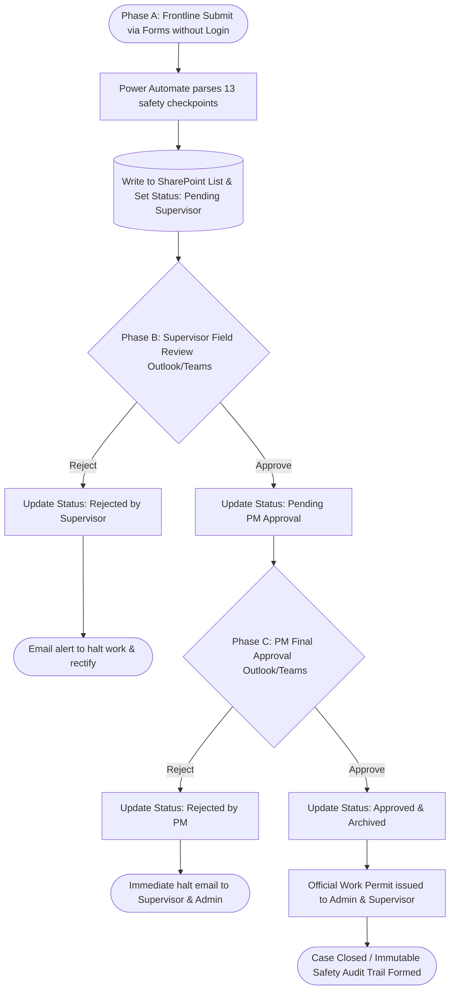
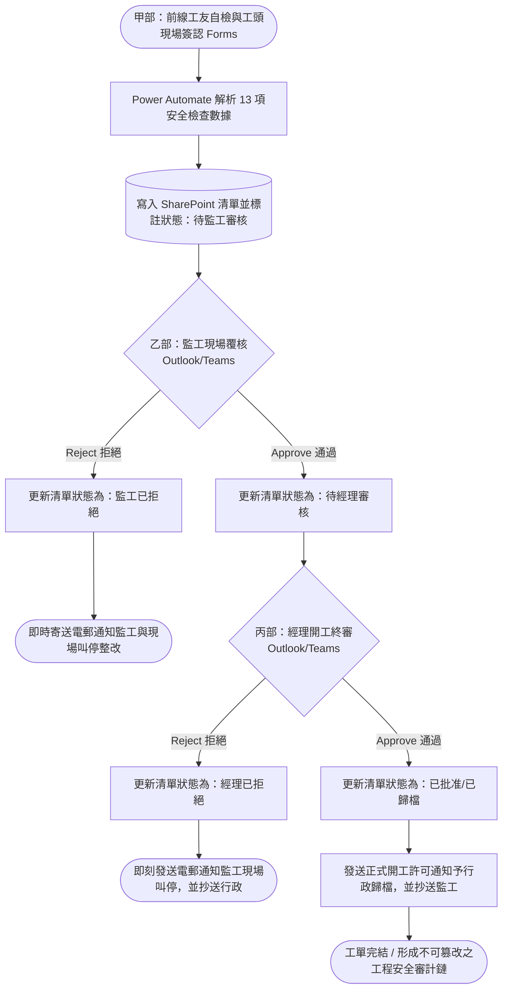

# EnterpriseDemo-SiteworksPSPJC 
### Enterprise Siteworks Pre-Start & Post-Job Checklist Governance System (Demo)
### 施工組開工(前和後)自檢與安全審批治理系統

> **"Zero-License, Multi-Tier Approval Construction Site Safety Governance Engine"**  
> **「零額外授權成本、前線極簡採集與雙層審批之工地施工安全治理系統」**

🌍 **Language Select (語言選擇):**
*   [🇬🇧 English Version](#-english-version)
*   [🇭🇰 繁體中文版本](#-繁體中文版本)

---

## 🇬🇧 English Version

### 📌 Executive Summary
**This repository is an Enterprise Demo showcasing how to implement Frontline Safety Governance using M365 Low-Code and State Machine architecture.**

**EnterpriseDemo-SiteworksPSPJC** is a paperless compliance governance solution designed for high-risk operations and safety management in construction sites. 

This project completely eliminates traditional paper-based inspection forms and error-prone PDF snapshot mechanisms. Built on the **Microsoft 365 native ecosystem (Forms, SharePoint Online, Power Automate, and Approvals)**, and requiring **zero additional Power Platform Premium licenses**, it achieves a 100% automated enterprise-grade safety closed-loop: "Frictionless Frontline Capture ➔ SharePoint State Machine Database ➔ Supervisor Field Review ➔ Project Manager Final Approval ➔ Automated HR/Admin Archiving."

### 🏛️ Workflow Lifecycle & Governance Closed-Loop
The pain points of traditional site inspection processes lie in "cumbersome frontline logins, delayed approvals, and the inability to immediately halt high-risk violations." This system uses a SharePoint State Machine and sequential approval architecture to ensure every application is transparent and tamper-proof:

### 📋 Governance Matrix

| Phase | Role | Platform | Action & Audit Trail |
| --- | --- | --- | --- |
| **A: Capture** | Workers & Foreman | Microsoft Forms | Scan QR code to submit without login. Complete 13 high-risk safety checks (e.g., permits, PPE, height work) with dual real-name electronic declarations. |
| **B: Review** | Site Supervisor | Outlook / Teams | System routes Adaptive Cards to the assigned Supervisor. Click link to upload field photos, verify safety, and click Approve. |
| **C: Approval** | Project Manager | Outlook / Teams | PM reviews the full checklist and Supervisor's remarks. Grants official work permit or halts operations for severe violations. |
| **D: Archive** | Admin / HR | SharePoint Online | Admins only receive notifications upon final PM decision. State machine locks the record, ensuring readiness for OSHA/client safety audits. |

### ⚙️ Technical Architecture

1. **Frictionless Capture:** Utilizes anonymous MS Forms and dynamic dropdown routing for frontline workers without corporate M365 accounts.
2. **State Machine Pattern:** Leverages SharePoint Lists as a lightweight relational database and state machine, driven by status nodes (`Pending Supervisor` ➔ `Pending PM` ➔ `Archived`).
3. **Master Data Driven:** A separate `Supervisor-Directory` list manages personnel. Power Automate uses OData Filter Queries to route approvals dynamically, eliminating hardcoded emails.
4. **Strict Authorization Gating:** Prevents the administrative hazard of premature work commencement. The system strictly restricts official work permits from being dispatched to administration and frontline teams until the Project Manager has completed final approval, eliminating interim status ambiguity and establishing defensible audit boundaries.
5. **Zero-License Cost:** 100% reliant on Standard Connectors (Forms, SharePoint, Approvals), saving significant Premium licensing costs.

---

## 🇭🇰 繁體中文版本

### 📌 專案摘要

**本專案為企業級開源示範，展示如何運用 M365 低代碼與狀態機架構落實前線施工安全治理。**

**EnterpriseDemo-SiteworksPSPJC** 是一套針對工程與建築施工現場高風險作業安全管理設計的無紙化合規治理方案。

本專案徹底捨棄傳統紙本巡查表與易出錯的 PDF 快照轉檔機制。以 **Microsoft 365 原生生態（Forms、SharePoint Online、Power Automate 及 Approvals）** 為基礎架構，在**無需購買 Power Platform Premium 授權**的前提下，實現「前線免登入掃碼填報 ➔ SharePoint 狀態機主數據庫 ➔ 現場監工實質初審 ➔ 項目經理終審放行 ➔ 助理與行政合規歸檔」的全自動化企業級安全閉環。

### 🏛️ 流程生命週期與治理閉環

傳統地盤自檢流程的最大痛點在於「前線帳號登入繁瑣、審核滯後、無法即時叫停高風險違規作業」。本系統透過 SharePoint 狀態機（State Machine）與順序式審批，確保每一筆開工申請的狀態透明且絕對防竄改：

### 📋 業務四部曲對照表

| 階段 | 責任角色 | 承載平台 | 處置動作與審計紀錄 |
| --- | --- | --- | --- |
| **甲部：現場自檢** | 工友 & 工頭 | Microsoft Forms | 透過 QR Code 免登入填報。完成 13 項高風險安全自檢（工作許可、高空作業等）並提交雙人實名簽認。 |
| **乙部：監工初審** | 現場負責監工 | Outlook / Teams | 系統動態派發審批卡片至負責監工信箱。監工點擊直達連結巡視現場補充照片，確認後點擊 Approve。 |
| **丙部：經理終審** | 項目經理 | Outlook / Teams | 接收包含完整檢查摘要與監工意見之終審卡片，確認合規後簽發正式開工許可。若駁回則流程中斷並警告現場。 |
| **丁部：合規歸檔** | 助理 / HR | SharePoint Online | 僅在經理終審批核或否決時正式接收通知。清單狀態機自動鎖定，備戰勞工處 (OSHA) 或業主安檢。 |

### ⚙️ 技術亮點與進階架構

1. **極簡前線採集 (Frictionless Capture)：** 針對工地前線無企業帳號的限制，採用 Forms 公開免登入設計，結合下拉式動態監工路由，達成掃碼即填的高效體驗。
2. **SharePoint 狀態機 (State Machine)：** 運用 SharePoint List 作為關聯式數據庫與狀態機。全流程透過狀態節點驅動，進度完全透明。
3. **主數據分離路由 (Master Data Driven)：** 設立獨立監工名冊清單。後台透過 OData Filter Query 動態解析監工電郵，人事異動時只需維護清單，無需修改自動化代碼。
4. **授權門閘硬防禦 (Strict Authorization Gating)：** 杜絕「未批先做」的管理盲點。系統嚴格限制僅在項目經理完成終審後才向行政與前線派發正式開工許可，避免過渡狀態被誤解為開工許可，落實工程審計的決策責任邊界。
5. **零額外授權架構 (Zero-License Cost)：** 全架構 100% 採用 Standard Connectors，替企業省下高額 Premium 授權開銷。

---

## 📄 License & Disclaimer (版權與免責聲明)

This project is licensed under the **MIT License**.

**Disclaimer:** This project is a generic enterprise demo created for academic, safety compliance, and architectural research. All data, organizational names, and endpoints used are fictional or generic placeholders. It does not constitute legal or occupational safety advice.

本專案採 **MIT License** 授權發佈。

**聲明：** 本專案為學術、安全合規與架構研究而建立之通用企業示範。所有使用的數據、組織名稱與端點皆為虛構或通用佔位符，不構成任何法律或職業安全建議。

